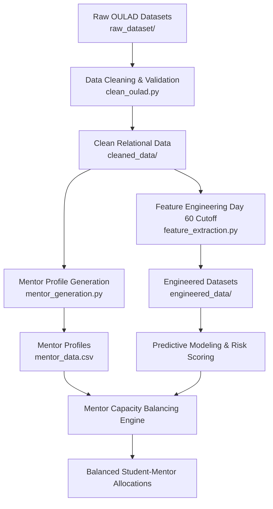

# Predictive Mentor Capacity Balancer

A data-driven machine learning and capacity allocation system that predicts student academic risk early in the term using the Open University Learning Analytics Dataset (OULAD) and intelligently balances mentor assignments according to workload, availability, and course specialization.

---

## 📌 Project Overview

Educational institutions face challenges identifying at-risk students before final assessments, often resulting in delayed interventions and uneven mentor workloads.

**Predictive Mentor Capacity Balancer** addresses this challenge through a multi-stage pipeline:
1. **Data Cleaning & Integration (`clean_oulad.py`)**: Sanitizes and validates relational learning analytics from OULAD while preserving legitimate missing records.
2. **Predictive Feature Engineering (`feature_extraction.py`)**: Computes student learning metrics up to a defined snapshot cutoff (Day 60) without data leakage to identify at-risk learners.
3. **Mentor Capacity & Profile Generation (`mentor_generation.py`)**: Simulates faculty mentor distributions with realistic capacities, weekly hours, domain specializations, and departmental mappings.
4. **Capacity Balancing & Allocation**: Matches high-need / at-risk students with eligible mentors optimizing for capacity limits and balanced mentor workloads.

---

## 🏗️ Architecture & Pipeline



---

## 📊 Dataset: Open University Learning Analytics (OULAD)

The system is built upon the Open University Learning Analytics Dataset, incorporating relational records:
- `studentInfo.csv`: Demographics, course registration, and final results.
- `studentRegistration.csv`: Registration and withdrawal dates.
- `studentAssessment.csv` & `assessments.csv`: Assessment types, submission dates, and performance.
- `studentVle.csv` & `vle.csv`: VLE (Virtual Learning Environment) interaction logs and activity metadata.
- `courses.csv`: Course codes, presentation terms, and module lengths.

---

## ⚙️ Key Modules & Components

### 1. Data Cleaning (`clean_oulad.py`)
- Standardizes data schemas, datatypes, and missing value indicators.
- Resolves inconsistencies without synthetic record fabrication.
- Aggregates high-frequency student-VLE interactions.
- Validates cross-table foreign keys across courses, assessments, and VLE activity.
- Generates `cleaning_report.csv` and `missing_values_report.csv`.

### 2. Feature Extraction (`feature_extraction.py`)
Extracts multi-dimensional features using a **strict cutoff date** (default: `Day 60`) to prevent future look-ahead data leakage:

| Category | Engineered Features |
| :--- | :--- |
| **Academic History** | `num_of_prev_attempts`, `studied_credits`, `registration_lead_days` |
| **Assessment Trajectory** | `average_assessment_score`, `latest_assessment_score`, `assessment_score_trend`, `assessment_score_std`, `assessment_weighted_score`, `assessment_completion_rate`, `missed_assessment_count`, `upcoming_assessment_count` |
| **VLE Engagement** | `total_clicks`, `active_days`, `average_daily_clicks`, `early_clicks` (Day 0–30), `recent_clicks` (Day 31–Cutoff), `engagement_change`, `inactive_days`, `resource_diversity`, `activity_type_diversity` |
| **Course Context** | `course_enrollment_count`, `enrollment_growth_rate`, `historical_course_failure_rate`, `course_duration_days`, `assessment_schedule_density` |
| **Target Variable** | `is_at_risk` (1 = Fail, 0 = Pass / Distinction) |

Outputs saved to `engineered_data/`:
- `student_course_features.csv`
- `student_model_training.csv`
- `feature_documentation.csv`

### 3. Mentor Profile Generation (`mentor_generation.py`)
Synthesizes mentor pools distributed across departmental disciplines (`AAA` through `EEE`):
- Assigns mentor capacity based on student enrollment volume.
- Models attributes: `experience_years`, `availability_hours_per_week`, and `max_student_capacity`. Current assignments can be supplied in a separate optional CSV.
- Computes `available_student_capacity` and `current_workload_percentage`.

---

## 🚀 Getting Started

### Prerequisites
- Python 3.12+
- [`uv`](https://docs.astral.sh/uv/) package manager (or `pip`)

### Installation

Clone the repository and install dependencies:

```bash
# Using uv (recommended)
uv sync

# Or using pip
python -m pip install .
```

### Running the Pipeline

1. **Clean raw OULAD data**:
   ```bash
   uv run python clean_oulad.py
   ```
2. **Extract features and build training matrices**:
   ```bash
   uv run python feature_extraction.py
   ```
3. **Generate mentor profiles from the cleaned OULAD enrollment data**:
   ```bash
   uv run python mentor_generation.py
   ```
4. **Train and save the risk model**:
   ```bash
   uv run python model_train.py
   ```
5. **Start the API**:
   ```bash
   uv run uvicorn main:app --reload
   ```

The API is available at `http://127.0.0.1:8000`; interactive endpoint
documentation is at `http://127.0.0.1:8000/docs`. Run commands from the project
directory.

`POST /forecast-demand` accepts either a path to the complete
`student_course_features.csv` file or full student-course rows in JSON. The
application automatically one-hot encodes the raw categorical columns, selects
the trained model's numeric features in artifact order, and ignores
identifiers and outcome columns. Missing or invalid numeric values in CSV
inputs are filled with zero according to the feature pipeline.
For example, to forecast directly from the generated CSV:

```json
{
  "student_dataset_path": "engineered_data/student_course_features.csv"
}
```

Alternatively, provide full rows under `students`, using the same columns as
the CSV. Each row can include `id_student` and `code_module`; these are used for
student identification and mentor specialization matching.

`POST /predict-risk` and `/forecast-demand` share the same flat student JSON
request schema. A single flat row can be sent unchanged to either endpoint;
`/predict-risk` returns one risk score, while `/forecast-demand` returns the
three-horizon forecast and capacity plan. The existing nested `features`
payload and `students` list are also accepted for compatibility. Both routes
validate that required numeric model features are present; nonnumeric JSON
values for those features receive a 422 response. CSV inputs retain the
feature-pipeline behavior of filling missing or invalid numeric values with 0.

The endpoint returns baseline, six-month, and course-end risk forecasts. For
each period,
`mentor_capacity_plans` includes the predicted at-risk student count and list,
mentor requirement, available mentors, capacity utilization, additional mentor
requirement, and a student-to-mentor allocation. Allocations use a
capacity-constrained risk-prioritized scoring algorithm; course specialization
is preferred, and assignments balance workload while considering experience
and weekly availability. Student prediction and allocation are processed in
batches to reduce peak memory for large datasets. If capacity is insufficient,
higher-risk students are prioritized and the rest are returned as unallocated.
The plan keys are `current`, `after_6_months`, and
`after_12_months_or_course_end`; `before_final_exam` is retained as a
compatibility alias for the course-end plan.

For individual JSON rows, the legacy nested `features` structure is still
supported:

```json
{
  "students": [
    {
      "id_student": 11391,
      "course_code": "AAA",
      "features": {
        "gender": "M",
        "region": "East Anglian Region",
        "highest_education": "HE Qualification",
        "imd_band": "90-100%",
        "age_band": "55<=",
        "disability": "N",
        "num_of_prev_attempts": 0,
        "studied_credits": 240
      }
    }
  ]
}
```

The abbreviated nested row above is not a complete prediction record; provide
all numeric model features from `student_course_features.csv`.

The demand forecast returns the model's risk estimate for the input snapshot,
a six-month scenario, and the course-end scenario (the end may occur before
12 months). The supplied feature pipeline builds its snapshot at approximately
the midpoint of each course, so the baseline is not the course start. Future
scenarios apply the trained classifier to feature estimates that continue the
observed engagement and assessment trends; they are not independently trained
six- or twelve-month prediction models. The 12-month/final-exam horizon uses
the course-end scenario when that occurs sooner.

To export model predictions for the standalone mentor allocation tool, call
`MentoringDemandForecaster.export_student_predictions(forecast_result,
"StudentPredictions.csv")`. The resulting CSV has exactly the standardized
student, course, classification, and probability columns required by
`mentor_management.py`; repeated course rows for a student are combined using
the maximum risk probability at each horizon, with the highest final-exam-risk
course retained for specialization matching. The mentor CLI does not load or
depend on the ML model:

```powershell
uv run python -c "import pandas as pd; from forecast_component import MentoringDemandForecaster; from main import forecaster, read_student_dataset, prepare_model_features, dataset_identifiers; rows=read_student_dataset('engineered_data/student_course_features.csv'); ids,courses=dataset_identifiers(rows); result=forecaster.forecast(prepare_model_features(rows), student_ids=ids, course_codes=courses); MentoringDemandForecaster.export_student_predictions(result, 'StudentPredictions.csv')"
uv run python mentor_management.py --students StudentPredictions.csv --mentors mentor_data.csv --output-dir mentor_management_outputs
```

Optionally pass current mentor assignments (`mentor_id`,
`current_assigned_students`) separately:

```powershell
uv run python mentor_management.py --students StudentPredictions.csv --mentors mentor_data.csv --existing-assignments current_mentor_assignments.csv --output-dir mentor_management_outputs
```

The standalone tool writes mapping, workload, and capacity-summary CSV files
for current, six-month, and final-exam horizons. Each horizon starts from the
same baseline mentor assignments; allocations are not carried across forecast
scenarios. Required mentor columns are `mentor_id`, `mentor_name`,
`department_id`, `department_name`, `specialization`, `experience_years`,
`availability_hours_per_week`, and `max_student_capacity`. If no separate
assignments CSV is given, current assignments are zero.

---

## 📁 Project Directory Structure

```text
predictive-mentor-capacity-balancer/
├── clean_oulad.py               # Data cleaning & validation pipeline
├── feature_extraction.py        # Snapshot feature engineering (Day 60)
├── mentor_generation.py         # Synthetic mentor profile & capacity generator
├── mentor_data.csv              # Sample generated mentor database
├── model_train.py               # Train and save model artifacts
├── main.py                      # FastAPI application
├── forecast_component.py        # Student risk and demand forecasts
├── mentor_management.py         # Mentor capacity and allocation logic
├── models/                      # Created by model_train.py
├── pyproject.toml               # Project configuration & dependencies
├── README.md                    # Project documentation
├── cleaned_data/                # Cleaned OULAD tables & validation reports
├── engineered_data/             # Extracted features & model training sets
├── raw_dataset/                 # Original OULAD CSV files
└── src/
    └── predictive_mentor_capacity_balancer/
        └── __init__.py          # Main application package entrypoint
```

---

## 🛠️ Tech Stack & Dependencies

- **Runtime**: Python 3.12+
- **Data Manipulation**: [pandas](https://pandas.pydata.org/) (>= 3.1.0), [NumPy](https://numpy.org/) (>= 2.5.4)
- **Machine Learning & Modeling**: [scikit-learn](https://scikit-learn.org/) (>= 1.9.1)
- **Environment & Build Management**: [uv](https://github.com/astral-sh/uv)

---

## ⚖️ Allocation & Balancing Strategy

The capacity balancing algorithm addresses common resource allocation bottlenecks in academic mentoring:

1. **Risk Stratification**:
   - Students are prioritized based on predicted failure probability (`risk_score`).
   - Students meeting the forecast's configured risk threshold (0.65 by default) receive prioritized mentor matching.
2. **Specialization & Course Alignment**:
   - Departmental module matches are preferred; capacity fallback is used when no matching specialist has room.
3. **Workload Constraints**:
   - Mentors cannot be assigned beyond `max_student_capacity`.
   - Workload index is balanced across available mentors to prevent mentor burnout:
     $$\text{Workload Index} = \frac{\text{Assigned Students}}{\text{Max Student Capacity}} \times 100$$
   - The global assignment minimizes specialization mismatch and projected workload while considering mentor experience and weekly availability.
4. **Capacity Re-evaluation**:
   - Dynamic rebalancing triggers if a mentor's weekly availability changes or after major assessment submission milestones.

---

## 🗺️ Roadmap & Next Steps

- [x] OULAD data cleaning and integrity validation pipeline (`clean_oulad.py`).
- [x] Day 60 cutoff snapshot feature engineering (`feature_extraction.py`).
- [x] Faculty mentor profile generation with realistic workloads (`mentor_generation.py`).
- [ ] Train predictive risk models (Random Forest, Gradient Boosting, Logistic Regression baselines).
- [x] Implement capacity-constrained minimum-cost optimization for mentor allocation.
- [ ] Implement interactive CLI and dashboard for departmental advisors to view load distributions and student risk alerts.
- [ ] Add unit and end-to-end integration tests for data pipelines.

---

## 📄 License & Attribution

- Built using the [Open University Learning Analytics Dataset (OULAD)](https://analyse.kmi.open.ac.uk/open_dataset), distributed under the Creative Commons Attribution 4.0 International (CC BY 4.0) license.
- Project maintained by the development team. Contributions, feature proposals, and issue reports are welcome!
